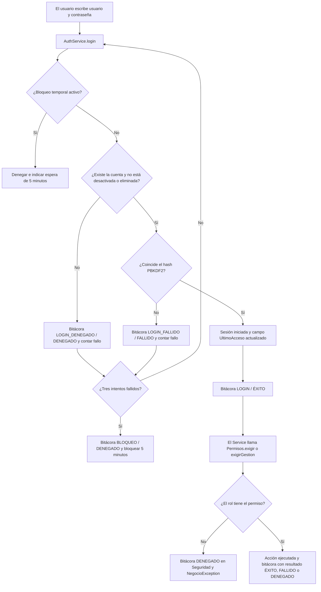

# BusFlow

**BusFlow** es una aplicación de escritorio construida con **Java Swing** y **SQL Server** para gestionar conductores, autobuses, rutas, asignaciones, disponibilidad, usuarios y bitácora. Proyecto final de ITLA. El nombre del proyecto y de la aplicación es **BusFlow**; el logotipo está incluido como recurso en `src/main/resources/logo-busflow.png`.

**Autor:** Adael Araujo Pineda - Matrícula 2025-1127

## Entrega final

| Requisito | Estado |
|---|---|
| Proyecto compilable y ejecutable | `mvn clean package` genera `target/busflow-1.0.0.jar`; también hay lanzador de escritorio |
| Todos los módulos implementados | 11 módulos operativos según la sección siguiente |
| Conexión a base de datos estable y operativa | Configuración externa, timeouts, 36 procedimientos originales más 4 nuevos de seguridad y modo demostración automático |
| Validaciones en funcionalidades críticas | 94 pruebas automáticas (78 originales + 16 de seguridad) más reglas en SQL Server |
| Código limpio, organizado y versionado | Capas ui, service, dao, model, demo y util; historial en GitHub |

No se agregaron tecnologías nuevas a la aplicación. La interfaz usa Swing, FlatLaf 3.5.4, el driver JDBC de SQL Server y JUnit 5 solo para pruebas. Los iconos son dibujos Java2D propios y el logotipo de BusFlow se carga desde los recursos. El paquete de escritorio usa `jlink`, incluido en el JDK, para llevar un entorno Java reducido sin instalar nada en otra computadora.

## Diseño de la interfaz

El rediseño toma como referencia `Mockups_Interfaces_Control_Autobuses.pdf` y la identidad **BusFlow**:

- Login de 1000x620 con panel verde oscuro, logotipo de BusFlow, marca **BUSFLOW**, bus dibujado y formulario blanco con placeholder, mostrar contraseña y errores en línea.
- Ventana principal de 1180x760 con sidebar de 240 px agrupada en **GENERAL**, **OPERACIÓN** y **SISTEMA**, logotipo, avatar con iniciales y ficha del usuario.
- Barra superior de 66 px con título de sección, usuario, rol, estado **Sistema activo / Sin conexión / Modo demostración**, cambio de contraseña y cierre de sesión.
- Tipografía moderna del sistema: se selecciona automáticamente entre `Segoe UI Variable`, `Inter`, `Aptos` y `Segoe UI` según esté instalada, sin archivos ni dependencias nuevas.
- Navegación con `CardLayout`, sin recargar ventanas.
- Tablas con filas alternas, orden por columnas, etiquetas de estado y buscador con placeholder.
- Formularios modales unificados: nuevo registro, editar registro, crear usuario y cambiar contraseña.
- Selector desplegable de fechas y horas con calendario y combos de hora/minuto en Asignaciones, Disponibilidad, Bitácora y vencimiento de licencia; no requiere escribir texto.
- Inicio con tarjetas de indicadores, **Actividad reciente** desde la bitácora y **Alertas** desde licencias por vencer.
- Paleta extraída de los mockups: fondo `#F4F6F4`, superficie `#FFFFFF`, verde oscuro `#113B2D`, verde principal `#0A6B4D`, acento `#16855D` y verde claro `#DBEFE4`.

## Módulos

| Módulo | Funciones |
|---|---|
| Acceso | Login, roles, bloqueo temporal de 5 minutos tras 3 fallos y cierre de sesión |
| Usuarios | Jerarquía SUPERADMINISTRADOR > ADMINISTRADOR > USUARIO GENÉRICO; crear, editar, restablecer clave, desactivar, eliminar lógicamente y reactivar |
| Contraseña | Cambio propio con verificación de contraseña actual y nueva diferencia |
| Conductores | Altas, búsqueda, estados, licencias vigentes y alerta de vencimiento |
| Autobuses | Altas, búsqueda, cambio de estado y control de capacidad |
| Rutas | Altas, búsqueda, desactivación y validación de origen/destino |
| Asignaciones | Programación de viajes con control de licencia, recursos activos y solapes |
| Disponibilidad | Consulta de conductores y autobuses libres por rango de fechas |
| Inicio | Indicadores, actividad reciente y alertas |
| Bitácora | Filtros por usuario, acción y rango de fechas (solo administrador) |
| Exportación | Generación de `asignaciones.csv` desde la tabla visible (solo administrador) |

**Superadministrador:** ve todos los módulos, hereda las capacidades del administrador y puede además crear otros superadministradores y configurar la seguridad. No puede desactivar ni eliminar al último superadministrador activo, ni desactivar o quitar el rol a su propia cuenta.

**Administrador:** ve todos los módulos, puede crear usuarios y administradores, editar, restablecer claves, desactivar, dar de baja lógicamente, reactivar y exportar. No puede crear superadministradores ni modificar cuentas de mayor jerarquía.

**Usuario genérico:** ve Inicio, Conductores, Autobuses, Rutas, Asignaciones y Disponibilidad solo para consultar. El título muestra **Panel de consulta**, no aparecen los botones **Nuevo**, **Exportar CSV** ni los módulos **Usuarios** o **Bitácora**.

### Jerarquía y permisos por rol

La jerarquía es **SUPERADMINISTRADOR (nivel 3) > ADMINISTRADOR (nivel 2) > USUARIO GENÉRICO (nivel 1)**. Un administrador gestiona cuentas de jerarquía igual o inferior; intentar gestionar una cuenta superior se deniega y se registra en la bitácora.

| Permiso | Usuario genérico | Administrador | Superadministrador |
|---|---|---|---|
| `CONSULTAR` | Sí | Sí | Sí |
| `GESTIONAR_OPERACION` | No | Sí | Sí |
| `ADMINISTRAR_USUARIOS` | No | Sí | Sí |
| `CONSULTAR_BITACORA` | No | Sí | Sí |
| `CONFIGURAR_SEGURIDAD` | No | No | Sí |
| `EXPORTAR` | No | Sí | Sí |

Los permisos están centralizados en `Permisos.exigir(...)` y `Permisos.exigirGestion(...)` dentro de la capa `service`. La interfaz oculta botones, pero la validación real ocurre siempre en el servicio: aunque se invoque un servicio desde otro lugar, una acción sin permiso lanza `NegocioException` y escribe un registro `DENEGADO`.

### Flujo de autenticación y autorización



El bloqueo se activa tras 3 fallos y dura 5 minutos. Ningún registro de bitácora incluye contraseñas: solo acción, tabla, identificador, detalle no sensible y resultado (`ÉXITO`, `FALLIDO` o `DENEGADO`).

### Panel Usuarios

El panel muestra cinco indicadores (**Usuarios registrados**, **Activos**, **Inactivos**, **Superadministradores** y **Bajas lógicas**), buscador por usuario/rol/estado, filtros de estado y rol, orden por usuario, rol, estado, fecha de creación o último acceso, y las columnas **Usuario**, **Rol**, **Estado**, **Fecha creación**, **Último acceso** y **Acciones**. Las acciones disponibles son crear usuario, crear superadministrador (solo para ese rol), editar, restablecer clave, desactivar, eliminar lógicamente y reactivar; una fila puede mostrar **Solo lectura** cuando el actor no puede gestionarla.

## Modo demostración sin base de datos

Si SQL Server está apagado, `db.properties` no tiene la contraseña real o la base no tiene los procedimientos, la aplicación abre automáticamente en **modo demostración**:

- No intenta conectarse a SQL Server ni pide contraseña.
- Carga datos de ejemplo: 4 conductores, 3 autobuses, 3 rutas, asignaciones y bitácora.
- Permite crear usuarios, administradores, superadministradores y registros con las mismas validaciones de negocio.
- Los cambios viven en memoria mientras la ventana esté abierta; al cerrar se reinician.
- El chip de la barra superior muestra **Modo demostración** y el login recuerda las credenciales de prueba: `admin` / `Admin123!`, `usuario` / `Usuario123!` y `superadmin` / `Super123!`. Son solo para demostración y pruebas; no se usan en un entorno real.

También se puede forzar con:

```
java -jar target/busflow-1.0.0.jar --demo
```

## Arquitectura

```
src/main/java/com/itla/autobuses
|-- Main.java          Punto de entrada
|-- ui/                Swing: Tema, Iconos, frames, paneles y diálogos
|-- service/           Reglas de negocio, permisos, validaciones y FabricaServicios
|-- dao/               CallableStatement contra procedimientos almacenados
|-- demo/              DAO en memoria y datos de ejemplo para el modo demostración
|-- model/             Entidades del dominio
`-- util/              ConexionDB, Sesion, Seguridad y NegocioException
src/main/resources     db.properties y logo-busflow.png
database/script.sql    Tablas, datos iniciales, procedimientos, restricciones y trigger
scripts/               Generador del paquete y acceso directo de escritorio
src/test/java          Pruebas JUnit 5 con DAO en memoria
test-reports           Resumen de ejecución de pruebas
```

Patrones: **Singleton**, **DAO**, **Factory** y capa de **servicios**. Seguridad: PBKDF2-HMAC-SHA256 con salt aleatorio. La interfaz no contiene SQL.

## Requisitos

- JDK 17 o superior y Maven 3.8 o superior para compilar.
- SQL Server Express o Developer con TCP/IP habilitado en el puerto 1433 solo para el modo base de datos.
- No se necesita Java ni SQL Server instalados para abrir el paquete de escritorio generado.

## Instalación y ejecución

### Opción A: desde el escritorio sin instalar nada

En la computadora de desarrollo, ejecuta:

```powershell
powershell -ExecutionPolicy Bypass -File scripts\preparar-escritorio.ps1
```

Ese script compila, crea `BusFlow` en el Escritorio con un entorno Java incluido, copia el JAR y el logotipo, y crea el acceso directo **BusFlow**. En otra computadora basta con copiar la carpeta `BusFlow` y hacer doble clic en **Iniciar BusFlow.bat** o en el acceso directo.

El `db.properties` incluido en esa carpeta conserva `TuPasswordAqui` para no filtrar credenciales; por eso el programa abre en modo demostración. Si quieres usar tu SQL Server en esa misma computadora, copia tu `db.properties` real a la carpeta; no lo compartas con otra persona.

### Opción B: compilar y ejecutar con Java

1. Ejecuta `database/script.sql` completo en SSMS o Azure Data Studio. Crea la base `ControlAutobuses`, las tablas, los datos iniciales, los procedimientos, las restricciones y el trigger `TR_Asignacion_Solape`. El script es repetible: usa `CREATE OR ALTER PROCEDURE` y comprobaciones `IF COL_LENGTH` / `IF NOT EXISTS`, por lo que puede ejecutarse otra vez sobre una base existente sin borrar datos; conserva los 36 procedimientos originales y agrega 4 nuevos.
2. Configura la conexión. El programa busca `db.properties` primero en el directorio de trabajo y después junto al JAR. El archivo versionado es:

   ```properties
   db.url=jdbc:sqlserver://localhost:1433;databaseName=ControlAutobuses;encrypt=true;trustServerCertificate=true
   db.user=sa
   db.password=TuPasswordAqui
   ```

   Reemplaza `TuPasswordAqui` por tu contraseña real en una copia externa ignorada por Git. Si el placeholder sigue presente, la aplicación abre en modo demostración.

3. Compila y empaqueta:

   ```
   mvn clean package
   ```

4. Ejecuta:

   ```
   java -jar target/busflow-1.0.0.jar
   ```

En el primer arranque con base de datos se crean las cuentas iniciales si cada usuario no existe todavía:

| Perfil | Usuario | Contraseña | Uso |
|---|---|---|---|
| Superadministrador (demo) | `superadmin` | `Super123!` | Solo demostración y pruebas |
| Administrador | `admin` | `Admin123!` | Solo demostración y pruebas |
| Usuario genérico | `usuario` | `Usuario123!` | Solo demostración y pruebas |

Cámbiala desde **Cambiar contraseña** en la barra superior. Si cambias la contraseña del administrador, el arranque siguiente no la restaura porque comprueba el nombre de usuario, no el total de registros. En modo demostración las cuentas se siembran con esas mismas credenciales.

### Migración SQL repetible y superadministrador inicial

`database/script.sql` puede ejecutarse las veces que sea necesario sobre una base ya creada: agrega columnas y el rol `SUPERADMINISTRADOR` solo si faltan, usa `CREATE OR ALTER PROCEDURE`, no elimina tablas ni datos y conserva los 36 procedimientos originales. Los 4 procedimientos nuevos son `sp_Usuario_Desactivar`, `sp_Usuario_Reactivar`, `sp_Usuario_RegistrarAcceso` y `sp_Bitacora_InsertarSeguro`. Las columnas nuevas son `Usuario.EstadoCuenta`, `Usuario.FechaModificacion`, `Usuario.UltimoAcceso`, `Usuario.Eliminado`, `Usuario.FechaEliminacion` y `Bitacora.Resultado`.

Para definir la cuenta real del superadministrador en el primer arranque con base de datos, establece ambas variables de entorno antes de iniciar:

```powershell
$env:BUSFLOW_SUPERADMIN_USER = "superadmin"
$env:BUSFLOW_SUPERADMIN_PASSWORD = "ClaveSegura123!"
java -jar target/busflow-1.0.0.jar
```

- Si ambas variables existen y pasan las validaciones de usuario y contraseña, se crea ese superadministrador cuando todavía no hay ninguno.
- Si no están definidas, se promueve al administrador inicial `admin` sin cambiar su contraseña; si existe otro administrador activo, se usa ese como respaldo.
- No se degradan otros administradores y el proceso es repetible: si ya existe un superadministrador, no hace nada.
- En modo demostración la cuenta sembrada es `superadmin` / `Super123!`, independientemente de las variables.

Las credenciales de demostración son solo para prácticas; en un entorno real usa tus propias credenciales y no las versiones.

## Validaciones críticas

- Usuarios: complejidad de contraseña, rol existente, no reutilizar la contraseña actual, jerarquía de roles, no conceder roles superiores, no desactivar ni degradar la propia cuenta, no eliminar al último superadministrador activo, baja lógica y reactivación con auditoría.
- Conductores: cédula de 11 dígitos, teléfono, formato de licencia y vigencia para asignar viajes.
- Autobuses: placa única, año válido y capacidad entre 1 y 200.
- Rutas: origen y destino obligatorios y diferentes, distancia y duración dentro de rango.
- Asignaciones: no editar ni cancelar estados terminales, licencia vigente, recursos activos y sin solapes.
- Base de datos: restricciones de capacidad, rango de ruta y destino diferente, además del trigger `TR_Asignacion_Solape`.
- Modo demostración: reutiliza los mismos servicios, por lo que las reglas anteriores también se aplican sin SQL Server.

## Pruebas

```
mvn test
```

| Grupo | Clases | Pruebas |
|---|---|---|
| Modelo y utilidades | `ModeloTest`, `SeguridadTest`, `SesionTest` | 13 |
| Acceso y usuarios | `BloqueoLoginTest`, `UsuarioServiceTest`, `CambiarPasswordPropioTest`, `CrearAdministradoresTest` | 12 |
| Perfil normal | `PerfilUsuarioNormalTest` | 3 |
| Operaciones | `ConductorServiceTest`, `AutobusServiceTest`, `RutaServiceTest`, `AsignacionServiceTest`, `PanelServiceTest` | 31 |
| Integración y reglas finales | `FlujosIntegracionTest`, `ValidacionesCriticasTest` | 17 |
| Modo demostración | `ModoDemostracionTest` | 2 |
| Seguridad avanzada | `SeguridadAvanzadaTest` (`SEG-01` a `SEG-16`) | 16 |

**Total: 94 pruebas (78 originales conservadas + 16 nuevas), 0 fallos, 0 errores.** No requieren SQL Server porque los servicios reciben los DAO por constructor o por la fábrica en modo demostración. El detalle queda en `test-reports/log-ejecucion.txt` y en `target/surefire-reports`; asegúrate de regenerar el resumen con la ejecución vigente de 94 pruebas.

## Verificación manual

1. Ejecutar `database/script.sql` completo (es repetible) o dejar que el programa abra en modo demostración.
2. Abrir desde el acceso directo **BusFlow** del Escritorio o con `mvn clean package` y el JAR.
3. Entrar con `admin / Admin123!` (o con el superadministrador definido por las variables de entorno), cambiar la contraseña y volver a entrar.
4. En **Usuarios**, crear un usuario genérico y otro administrador; entrar con la nueva cuenta de administrador para confirmar que puede administrar.
5. Si entró como superadministrador, usar **Crear superadministrador**; si entró como administrador, confirmar que esa opción no aparece y que intentar gestionar una cuenta superior muestra el aviso de jerarquía.
6. Probar **Restablecer clave**, **Desactivar**, **Eliminar** (baja lógica) y **Reactivar**; verificar que los cinco indicadores y las columnas **Estado**, **Fecha creación** y **Último acceso** se actualizan, y que las acciones denegadas aparecen como `DENEGADO` en **Bitácora** sin contraseñas.
7. Probar el buscador, los filtros de estado y rol y el orden por columnas del panel Usuarios.
8. Probar el bloqueo con 3 intentos fallidos y esperar 5 minutos.
9. Crear conductor, autobús, ruta y asignación; repetir la asignación en el mismo horario para confirmar el aviso de solape.
10. Revisar actividad y alertas en Inicio, filtrar Bitácora y exportar el CSV de asignaciones.
11. Cerrar sesión y entrar con `usuario / Usuario123!`. Confirmar que el rol muestra **Usuario Genérico**, el título es **Panel de consulta**, no aparecen **Nuevo**, **Exportar CSV**, **Usuarios** ni **Bitácora**, y que las tablas solo permiten consultar.
12. Verificar que no se puede desactivar la propia cuenta ni eliminar o desactivar al último superadministrador.
13. Verificar que el logotipo de BusFlow aparece en el acceso y en la barra lateral, y que el chip muestre **Sistema activo** con la base disponible o **Modo demostración** sin base.

## Versionado

Rama principal: `main`.
Remoto: `https://github.com/adael2012/BusFlow.git`.

Para publicar cambios futuros:

```
git add -A
git commit -m "descripcion del cambio"
git push origin main
```
